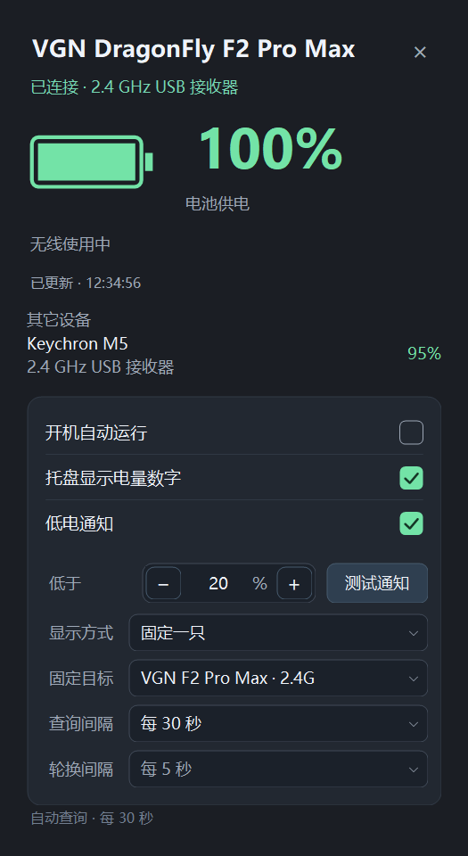

# VGN Battery

在 Windows 托盘查看 VGN、VXE、部分 ATK 和 Keychron 鼠标的剩余电量。通过 **2.4 GHz USB 接收器或 USB 数据线**读取，每 5 秒自动更新，无需一直打开厂商驱动。

这是非官方社区工具，支持范围和实测情况见下表。

**[下载最新版](https://github.com/zerobeyondlogic/vgn-battery/releases/latest)** · [报告问题](https://github.com/zerobeyondlogic/vgn-battery/issues) · [MIT 许可证](LICENSE)

发行包为 **Windows x64 免安装版**，包含运行环境，解压即可使用，无需另装 .NET 或管理员权限。目前已在 Windows 11 x64 验证。

## 界面预览




上图为界面和图标的演示图，不是各型号的实机测试截图。

## 主要功能

- **托盘电池图标**：正常读到电量时为绿色；断开、休眠或暂未响应时为灰色，可选择是否显示数字。
- **自动识别型号**：优先读取设备返回的产品名称，通用接收器名称则使用已登记的型号信息。
- **点击查看详情**：显示电量、连接方式和更新时间。弹窗展开时保持置顶，可拖动文字、图形或空白区域移动；关闭只收起窗口，后台继续运行。
- **低电通知**：可开关通知并设置 1–99% 的阈值，低于阈值时发送 Windows 通知；提供“测试通知”按钮。
- **开机自动运行**：可选登录 Windows 后自动启动，主窗口和右键菜单的勾选状态同步。

程序只发送电量查询命令；Keychron 接收器还会被查询一次配对设备列表，用于显示型号名。程序不修改 DPI、回报率、配对或固件，也不发送网络请求。此版本**不读取蓝牙电量**，也不保证支持所有 VGN 型号。

## 开始使用

1. 从[最新版发布页](https://github.com/zerobeyondlogic/vgn-battery/releases/latest)下载 Windows x64 免安装 ZIP，完整解压到准备长期保存的文件夹。
2. 将鼠标切到 2.4G 模式并插入接收器，或使用支持数据传输的 USB 线连接。
3. 双击 `VgnBattery.exe`。程序只显示托盘图标，不自动弹出窗口。如果图标位于任务栏右下角的 `^` 隐藏区，将它拖到外面即可常驻。
4. 左键点击图标查看详情，再次点击或按窗口的关闭按钮收起；右键打开菜单。托盘数字、低电通知和开机启动均可在主窗口设置。

低电通知默认开启，阈值为 **20%**，只在读到有效电量且未充电时提醒。一次提醒后不会每 5 秒重复通知；充电、电量恢复到阈值以上 5 个百分点、换设备或修改提醒设置后，会重新允许提醒。

## 支持的鼠标

下表表示已经登记电量协议的接口，**不等于本项目已逐台测试**。同名产品的不同版本或接收器可能使用不同协议。

| 型号或系列 | 已登记连接方式 | 本项目实机验证 |
| --- | --- | --- |
| VGN F2 Pro Max | 2.4G 接收器、USB 有线 | 接收器已验证，读到 100%；有线待验证 |
| VGN F2 大师版 GT / Master GT | `391D:102D` 接收器、`391D:1032` 有线（v1.0.1 起） | 按官方驱动协议适配，实机待验证 |
| VGN F1 Pro | 2.4G 接收器、USB 有线 | 待验证 |
| VGN Dragonfly 4K 接收器 / 系列有线接口 | USB 接收器、有线 | 待验证；共享接收器不能确定唯一鼠标型号 |
| VXE R1 Pro / R1 Pro Max | 2.4G 接收器、USB 有线 | 待验证；部分 USB 标识共用 |
| VXE R1 SE+ | 2.4G 接收器（含已登记的 1K 接收器）、USB 有线 | 待验证 |
| VXE MAD R | 2.4G 接收器、USB 有线 | 待验证 |
| VXE MAD R Major Plus | 2.4G 接收器、USB 有线 | 待验证 |
| ATK F1 Ultimate | 2.4G 接收器、USB 有线 | 待验证 |
| ATK A9 Ultimate | 2.4G 接收器、USB 有线 | 待验证 |
| Keychron M5 | `3434:D028` Ultra-Link 8K 接收器、`3434:D048` 有线 | 接收器已验证，读到 100%；有线待验证 |
| Keychron M6 8K | `3434:D028` Ultra-Link 8K 接收器、`3434:D049` 有线 | 待验证 |

完整 USB 标识以 [DeviceCatalog.cs](src/DeviceCatalog.cs) 为准。只有登记型号且接口符合协议时才发送查询；尚未登记的同厂设备会显示识别出的名称和暂不支持状态，不尝试套用其它型号的命令。

两套电量协议使用不同的厂商集合：VGN / VXE / ATK 是 `FF02:0002` 的 17 字节报告，Keychron 是 `FFC1:0001` 的 64 字节报告。接口长度或用途不匹配时不会发送任何查询。

协议参考：[Nordic52 型号与电量查询](https://github.com/Fan4Metal/mouse_tray/blob/master/mouse_tray/drivers/chipset/nordic52.py)、[Dragonfly 4K 接口登记](https://github.com/HeyOkay/HaloBattery/blob/main/providers/pulsar.py)。本项目是独立开发的工具，未打包厂商驱动或第三方鼠标软件。

F2 Master GT 的设备编号与 17 字节电量协议依据 [VGN 官方网页驱动](https://drive.vgnlab.com.cn/) 的设备表和电量控制器。v1.0.0 只扫描 `3554` / `373B`，会漏掉该型号的 `391D` 厂商编号；使用该型号请升级到 v1.0.1 或更新版本。

Keychron 的 64 字节协议依据开源内核模块 [keychron-battery-dkms](https://github.com/csutcliff/keychron-battery-dkms) 与 `3434:D028` 的实机应答，记录见 [docs/KEYCHRON-M5.md](docs/KEYCHRON-M5.md)。接收器对任何鼠标都报同一 USB 编号，型号名由接收器的配对查询返回；鼠标本体通过数据线连接时由它自己的编号确定型号。

## 常见问题

**鼠标还能用，图标为什么变灰？**

鼠标可能休眠，或者接收器暂未回复。相同设备的接口仍在时，会保留最近一次有效电量，置灰并标注“上次读数”及原始时间。移动鼠标后会自动重试。接收器拔出或型号改变时会清空旧读数。

**只显示接收器名称，或者提示暂不支持？**

部分接收器只报告通用名称，且可以配对不同鼠标，无法据此精确推断型号。未登记的硬件或新协议需要另行适配。反馈问题时请提供型号、连接方式和 USB VID/PID；不要把“自动识别”理解为兼容全部 VGN 产品。

v1.0.1 起可右键托盘选择“导出设备信息”，生成仅含设备描述、VID/PID、接口用途与报告长度的 JSON，不含设备路径或序列号。该导出不发送电量或配置查询，可用于排查尚未支持的设备。

**蓝牙能看到电量，插着 USB 接收器却读不到？**

请确认鼠标本身已经切到 2.4G 模式。仅插着接收器、鼠标仍通过蓝牙连接时，USB 接收器不一定回复。若使用数据线，还需确认线缆支持数据传输。

**开启了低电通知，但没有弹出消息？**

先点击“测试通知”。Windows 通知设置、勿扰模式等可能阻止消息显示。真实低电通知只使用有效新读数，不根据灰色的历史读数重复提醒，充电时也不会触发。

**移动文件夹后，开机启动失效了？**

已经开启开机启动时，先退出旧版，再运行新位置的程序，会更新启动路径；新用户默认不开启。若更新失败，可将“开机自动运行”取消后再勾选一次。该设置只影响当前 Windows 用户，无需管理员权限。

**资源占用如何？**

一次 30 秒后台采样中，16 逻辑处理器电脑的全机平均 CPU 约 **0.026%**，工作集约 **67–73 MiB**，私有内存约 **15–20 MiB**，句柄和图形对象数量在采样期间保持稳定。这是短时样本，不是长期上限；打开界面、系统缓存和不同电脑都会影响结果。图标只在可见状态发生变化时重绘，隐藏窗口不重复刷新内容。

## 卸载与本地数据

先取消“开机自动运行”，再从托盘菜单选择“退出”，随后删除解压后的文件夹即可。设置和少量诊断文件保存在 `%LOCALAPPDATA%/VgnBattery`，不需要保留时也可删除。

程序不上传设备信息或日志。开机启动使用当前用户的 `HKCU/Software/Microsoft/Windows/CurrentVersion/Run` 中的 `VgnBattery` 项，取消勾选会移除该项。

## 从源码构建

需要 Windows、**PowerShell 7+** 和 **.NET 10 SDK**。

```powershell
# 本机开发版：输出到 dist，需要本机另装 .NET 10 Windows Desktop 运行时
.\build.ps1

# 可分发版：包含运行环境，运行离线检查并输出免安装 ZIP 到 releases
.\build-release.ps1
```

向他人分享时使用 `build-release.ps1` 生成的发行包，发行包不包含本机设置、日志或设备信息。

诊断参数：

```powershell
.\VgnBattery.exe --self-test   # 运行离线检查，结果写到程序旁 self-test.txt
.\VgnBattery.exe --enumerate   # 将匹配厂商的 HID 接口写到程序旁 devices.json
.\VgnBattery.exe --diagnose    # 枚举全部 HID，导出不含设备路径的 device-report.json
.\VgnBattery.exe --query       # 查询一次，结果写到本地数据目录的 status.json
.\VgnBattery.exe --show        # 运行并展开详情窗口
.\VgnBattery.exe --self-test --output-dir .\diagnostics  # 指定诊断结果目录
```

诊断结果默认写到程序旁；没有写入权限时回退到 `%LOCALAPPDATA%/VgnBattery/diagnostics`，也可用 `--output-dir` 指定目录。`devices.json` 含本机设备路径，反馈问题时仅摘取必要的型号和 VID/PID，不要直接整份公开上传。不要在托盘程序同时运行时单独执行 `--query`，避免两次查询相互竞争。

### 验证范围

2026-11-15，已在 Windows 11 x64、VGN F2 Pro Max 的 2.4G 接收器上读取到真实的 **100%** 电量，并连续收到间隔约 5 秒、校验正确的回复。已检查 150% 系统缩放下的型号、百分比、设置卡片和阈值控件，并验证从电池区域拖动窗口。

同日，Keychron M5 经 `3434:D028` Ultra-Link 8K 接收器读取到真实的 **100%** 电量，型号名由接收器的配对查询解析为 `Keychron M5`；连续 5 次查询在 2–40 ms 内返回。

另有 **65 项离线检查**覆盖协议解析、设备识别、托盘图标、拖动区域、设置边界、启动项迁移、设备报告脱敏和低电通知策略。离线检查通过不代表 GT、Keychron 有线、其它型号或 USB 有线连接已经实机验证。电量百分比由鼠标固件提供，可能受其量化、更新频率和休眠行为影响。

## 许可证

[MIT](LICENSE)。欢迎提交问题、兼容性反馈和改进。
